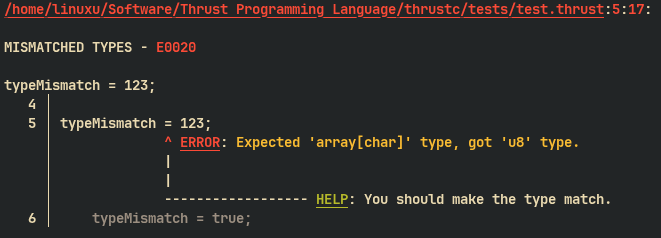
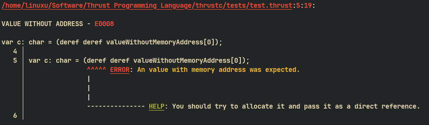
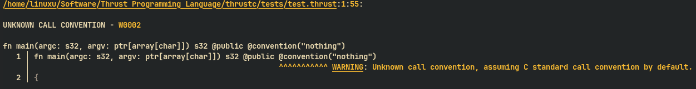
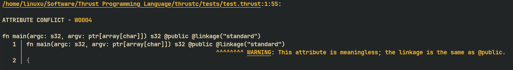

</img>

# The Thrust compiler

The compiler reports diagnostics like these:

Use `--enable-ansi-color` to display them in color. The option is off by default.

### Errors

#### Type mismatch

</img>

#### Value without address

</img>

#### Invalid atomic operation

`E0056` reports an atomic operation whose target has no atomic ordering, or whose ordering arguments are not valid for LLVM. Use `thrustc --explain E0056` for details.

### Warnings

#### Unknown call convention

</img>

#### Attribute conflict

</img>

Use `thrustc --explain W0004` or `thrustc --explain E0007` to understand a diagnostic. The compiler explains why the issue exists in the code when an explanation is available.
