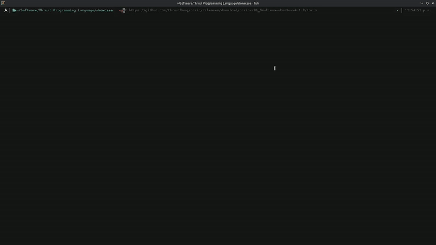

</img>

# Thrust Programming Language 

 </img>

A general-purpose, statically typed systems programming language. It is designed for verbose, accurate code and fast execution.

## What problem does it solve?

Thrust simplifies C and C++ APIs in a way that is easier to explain, and it integrates compiler control and common conveniences directly into the language.

## Getting started

> [!IMPORTANT]  
> The compiler is in an early development phase and has not made its major releases yet. Some edge cases still need handling, and the compiler is under constant testing and fuzzing.

## Torio

You can install the latest compiler toolchain through **Torio**, the main Thrust compiler-controller and package manager for the language.

Repository: https://github.com/thrustlang/torio



## Prebuilt binaries

If you don't want to build the project from scratch, check the available versions on GitHub releases.

[Thrust Compiler - GitHub Releases](https://github.com/thrustlang/thrustc/releases)

Supported platforms and architectures:

| Platform | Architecture | Release tag |
|---|---|---|
| Linux Ubuntu GNU | x64 `x86_64-unknown-linux-gnu` | `thrustc-x86_64-linux-ubuntu-v*.*.*` |
| Windows MSVC | x64 `x86_64-pc-windows-msvc` | `thrustc-x86_64-windows-msvc-v*.*.*` |
| macOS Apple Silicon | aarch64 `aarch64-apple-darwin` | `thrustc-aarch64-macos-v*.*.*` |
| macOS Intel | x64 `x86_64-apple-darwin` | `thrustc-x86_64-macos-v*.*.*` |

## From scratch

### Build dependencies

The compiler depends on the LLVM compiler infrastructure.

Automatically:

```console
$ git clone --depth=1 https://github.com/thrustlang/compiler-dependency-builder 
$ cd compiler-dependency-builder 
$ cargo build --release
$ ./target/release/compiler-dependency-builder
```

Another way:

```console
$ git clone --depth=1 https://github.com/thrustlang/compiler-dependency-builder 
$ cd compiler-dependency-builder 
$ cargo run 
```

For a high-level view of the command line, see [Compiler Dependency Builder - Commands & Flags](https://github.com/thrustlang/compiler-dependency-builder/blob/master/README.md).

Clone the repository and enter it:

```console
$ git clone --depth=1 https://github.com/thrustlang/thrustc 
$ cd thrustc
```

### Build Cargo/rustc dependencies

Some Cargo and rustc dependencies need additional libraries.

Install each Cargo dependency automatically:

#### Bash

```console
sh scripts/cargo-dependencies.sh
```

#### Fish

```console
fish scripts/cargo-dependencies.fish
```

#### CMD

```console
scripts\cargo-dependencies.bat
```

#### PowerShell

```console
.\scripts\cargo-dependencies.ps1
```

### Build the compiler

You need Rust installed with a recent version.

- \>= [Rust](https://www.rust-lang.org/) (v1.85.0)
- Rust 2024 Edition

Build the compiler with Rust:

```console
$ cargo build --release
$ ./target/release/thrustc --help
```

## Cross compilation

Thrust Compiler supports cross-compilation like [Clang](https://github.com/llvm/llvm-project/tree/main/clang).

### RISC-V 64-bit

```console
./thrustc main.thrust my_library.thrust \
  -target-triple riscv64-unknown-linux-gnu \
  -cpu sifive-u74 \
  -opt O3 
```

### WebAssembly

```console
./thrustc main.thrust my_library.thrust \
  -target-triple wasm32-unknown-unknown \
  -opt O3 
```

You can target macOS, Windows, Linux, and other platforms from your current system without switching machines.

## Commands and flags

For a high-level view of the command line, see [Thrust Compiler - Commands & Flags](https://github.com/thrustlang/thrustc/blob/master/CLI.md).

## Language syntax

The Thrust language syntax is documented in the [Thrust Syntax repository](https://github.com/thrustlang/syntax).

## Language server

For editor integration through the Language Server Protocol, especially for Visual Studio Code, see [Thrust LSP - Visual Studio Code](https://github.com/thrustlang/thrustc/blob/master/lsp/vscode/README.md).

## Compiler structure

The compiler's structure is described in [Thrust Programming Language - Compiler Structure](https://github.com/thrustlang/thrustc/blob/master/PROJECT_STRUCTURE.md).

## Contributing

See [Thrust Programming Language - Contributing](https://github.com/thrustlang/thrustc/blob/master/CONTRIBUTING.md) for how to contribute to the compiler.

## Rust code documentation

The Rust code structure in the compiler is documented at [Thrust Programming Language - Rust Code Documentation](https://thrustlang.github.io/thrustc/).

## Cargo alias

The command line shortcuts available across Rust and Cargo are listed in [Thrust Programming Language - Cargo Alias](https://github.com/thrustlang/thrustc/blob/master/CARGO_ALIAS.md).

## Commit conventions

See [Thrust Programming Language - Commit Conventions](https://github.com/thrustlang/thrustc/blob/master/COMMIT_CONVENTIONS.md) for the commit conventions to follow when delivering a GitHub commit.

## Compiler diagnostics

Examples of the compiler diagnostics you can find in thrustc are in [Thrust Programming Language - Compiler Diagnostics](https://github.com/thrustlang/thrustc/blob/master/COMPILER_DIAGNOSTICS.md).

## Compiler fuzzing

See [Thrust Programming Language - Compiler Fuzzing](https://github.com/thrustlang/thrustc/blob/master/COMPILER_FUZZING.md) for how to fuzz the compiler with stable and unstable features.

## Compiler releasing

See [Thrust Programming Language - Compiler Releasing](https://github.com/thrustlang/thrustc/blob/master/COMPILER_RELEASING.md) for how a new compiler version is released.

## Code of conduct

The code of conduct for project contributors is in [Thrust Programming Language - Code of Conduct](https://github.com/thrustlang/thrustc/blob/master/CODE_OF_CONDUCT.md).

## License

Thrust Compiler is distributed under the terms of the GNU General Public License (version 3). See LICENSE.txt file for details.
